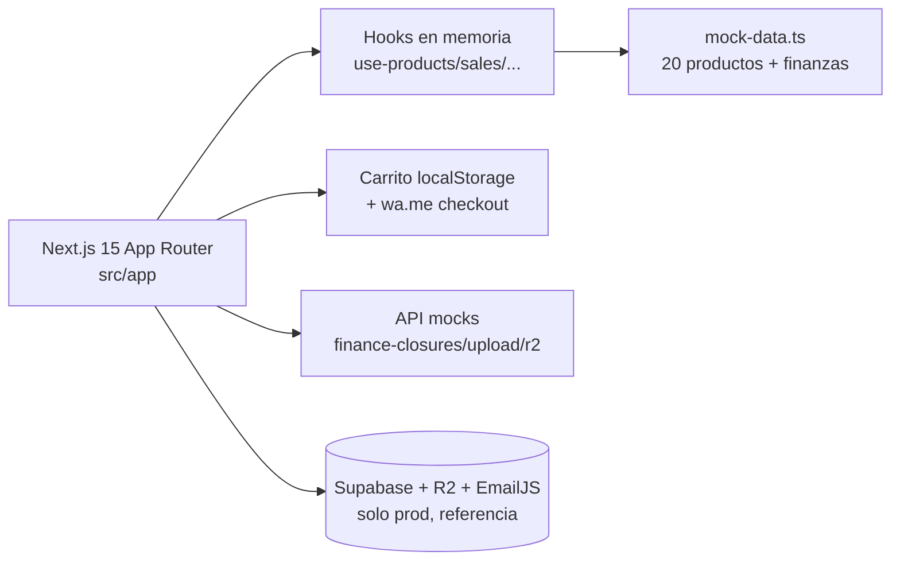

<div align="center">

# 📱 JustPhones — E-commerce de Fundas y Accesorios para iPhone

**Tienda online completa con panel admin, finanzas y checkout por WhatsApp. Next.js 15 + Supabase + R2 + Framer Motion.**

**Complete iPhone cases store with admin panel, finance dashboard and WhatsApp checkout. Next.js 15 + Supabase + R2.**

[](https://nextjs.org/)
[](https://www.typescriptlang.org/)
[](https://tailwindcss.com/)
[](https://www.framer.com/motion/)
[](https://justphones-fv.vercel.app)
[](#-autor-contacto-y-licencia)

**[🚀 Demo en vivo](https://justphones-fv.vercel.app) · [📦 Repo](https://github.com/FelipeDiazAimar/justphones) · [🇬🇧 English version](README.en.md)**

> Portfolio demo — tienda real adaptada a mock en memoria, sin DB ni login, lista para mostrar.

</div>

> **English TL;DR:** JustPhones is an iPhone cases/accessories store (Next.js 15 App Router) with public catalog (filters by model/category, search, product pages), persistent cart, WhatsApp checkout with real-time discount codes, and a **full admin panel without login in demo** (products, orders, finance with Recharts, discount codes, carousel, FAQs, models). All data lives in `src/lib/mock-data.ts` (in-memory, resets on reload). Real integrations (Supabase, R2, EmailJS) remain in code as production reference. Full English docs in [README.en.md](README.en.md).

---

## 📑 Tabla de contenidos

1. [Qué es y qué problema resuelve](#-qué-es-y-qué-problema-resuelve)
2. [Demo en vivo](#-demo-en-vivo)
3. [Características](#-características-tienda--admin--finanzas)
4. [Arquitectura](#-arquitectura)
5. [Stack y librerías](#-stack-y-librerías)
6. [Estructura](#-estructura)
7. [Quick Start](#-quick-start-30-segundos)
8. [Instalación completa](#-instalación-completa)
9. [Variables de entorno](#-variables-de-entorno)
10. [Scripts](#-scripts)
11. [Datos mock y códigos](#-datos-mock-y-códigos-para-probar)
12. [Rutas principales](#-rutas-principales)
13. [API mock](#-api-mock)
14. [Diseño y UX](#-diseño-y-ux)
15. [Deploy](#-deploy)
16. [Roadmap](#-roadmap)
17. [Troubleshooting](#-troubleshooting)
18. [Autor](#-autor-contacto-y-licencia)

---

## 💡 Qué es y qué problema resuelve

**JustPhones** es una tienda de fundas y accesorios para iPhone (iPhone 11 → 16 Pro) construida como app de producción real y adaptada a demo de portfolio: la DB **Supabase (PostgreSQL)** se reemplazó por estado en memoria, el storage **Cloudflare R2** por URLs de Unsplash, y el **login del admin** se removió para acceso directo desde el botón **Admin** del header.

| Antes (negocio sin sistema) | Ahora (JustPhones) |
|---|---|
| Catálogo por fotos sueltas en redes | Catálogo con filtros por modelo/categoría, búsqueda, ficha con colores/stock/galería |
| Pedidos por chat desordenados | Checkout por WhatsApp con mensaje formateado (productos, cantidades, precios, descuento) |
| Descuentos a mano, sin control | Códigos validados en tiempo real (`DEMO10`, `PROMO20`, `PORTFOLIO`, `BIENVENIDA`) |
| No saber qué deja cada producto | Dashboard financiero con ganancia neta, capital, patrimonio en stock, rentabilidad por método de pago y por producto |
| Cierres de caja en papel | Cierres mensuales con historial + costos fijos + sueldos + movimientos monetarios |

---

## 🚀 Demo en vivo

| Entorno | URL |
|---|---|
| 🌐 **Vercel (demo)** | https://justphones-fv.vercel.app |
| 💻 Local | http://localhost:9002 (`npm run dev` con Turbopack) |

Sin `.env`, sin credenciales, sin login: entrar y usar. El botón **Admin** lleva directo al panel.

---

## ✨ Características (tienda + admin + finanzas)

### Tienda pública
- Carrusel promocional, catálogo por modelo (iPhone 11–16 Pro) y categoría (fundas, accesorios, auriculares), filtros por subcategoría/modelo/stock, búsqueda por nombre/modelo.
- Ficha `/product/[id]` con selector de color, stock en tiempo real y galería.
- Carrito lateral: agregar/quitar, descuentos, persistencia `localStorage`.
- Checkout WhatsApp: genera texto formateado y abre `https://wa.me/<numero>?text=…`.
- FAQs acordeón + contacto (EmailJS en real).

### Panel `/admin` (sin login en demo)
| Sección | Qué hace |
|---|---|
| Productos | CRUD con imágenes, colores, stock, precios |
| Pedidos | Solicitudes de clientes, registrar ventas, descuentos |
| Finanzas | Dashboard completo (abajo) |
| Códigos | CRUD de descuentos (% + activo/inactivo) |
| Carrusel | Subir/ordenar imágenes home |
| FAQs / Modelos / Nombres | Contenido y compatibilidades |

### Dashboard `/admin/finanzas`
**Métricas por mes:** ingreso productos, movimientos monetarios, costos fijos, sueldos, costos de pedidos (restock), costos/ingresos totales, **ganancia neta**, **capital acumulado**, patrimonio en stock, items vendidos, conversión.
**Gráficos:** ventas día/mes/año (línea), por categoría (torta), ganancias vs costos (barras diario/semanal/mensual/por pedido).
**Tablas:** popularidad (ventas/pedidos/vistas), rentabilidad por método (lista/efectivo/débito), restock con costos/márgenes.
**Gestión:** costos fijos, sueldos, ingresos/egresos, cierres mensuales.

---

## 🏗️ Arquitectura



Estado con custom hooks + `useState` (cada hook inicializa desde `mock-data.ts` y simula latencia con `setTimeout`). Carrito → valida código → arma mensaje → `wa.me`. APIs retornan mocks (cierres, `{success:true}`, URLs Unsplash).

```ts
// src/hooks/use-products.ts (ejemplo)
const [products, setProducts] = useState<Product[]>(MOCK_PRODUCTS);
const addProduct = async (data) => {
  await new Promise(r => setTimeout(r, 400)); // latencia simulada
  setProducts(prev => [newProduct, ...prev]);
};
```

---

## 🛠️ Stack y librerías

Versiones de `package.json` (`nextn@0.1.0`, Next `15.3.8`):

| Capa | Paquete | Versión | Uso |
|---|---|---|---|
| Framework | `next` | `15.3.8` | App Router |
| UI | `react`, `react-dom` | `18.3.1` | Componentes |
| Lang | `typescript` | `5.x` | Tipos + `typecheck` |
| Estilos | `tailwindcss`, `tailwindcss-animate`, `tailwind-merge`, `clsx`, `class-variance-authority` | `3.4.1` | shadcn/ui |
| Radix | 14 paquetes (dialog, select, toast…) | `1.x/2.x` | Base UI |
| Animación | `framer-motion` | `11.0.0` | Transiciones |
| 3D/fondo | `ogl` | `1.0.3` | Efecto Aurora welcome |
| Recorte img | `react-image-crop` | `11.0.5` | Admin carrusel/productos |
| Gráficos | `recharts` | `2.15.1` | Finanzas |
| Forms | `react-hook-form`, `@hookform/resolvers`, `zod` | `7.54.2 / 3.24.2` | Validación |
| Carrusel | `embla-carousel-react`, `autoplay` | `8.6.0` | Hero |
| Temas | `next-themes` | `0.3.0` | Dark/light |
| Iconos | `lucide-react` | `0.475.0` | Iconografía |
| Fechas | `date-fns`, `react-day-picker` | `3.6.0 / 8.10.1` | Períodos/Filtros |
| DB prod | `@supabase/supabase-js`, `@supabase/ssr` | `2.52.1 / 0.5.1` | Ref prod (mock en demo) |
| Storage prod | `@aws-sdk/client-s3` | `3.850.0` | R2 ref prod |
| Email prod | `@emailjs/browser` | `4.4.1` | Contacto real |
| IA | `genkit`, `@genkit-ai/googleai`, `@genkit-ai/next` | `1.13.0` | Flujos `src/ai` |
| Analytics | `@vercel/analytics` | `1.5.0` | Métricas |
| Misc | `firebase`, `dotenv`, `patch-package` | `11.9.1` | Compat/scripts |

---

## 📁 Estructura

```
justphones/justphones/
├── src/
│   ├── app/{admin/{products,pedidos,finanzas,codigos,carousel,faqs,models,names},
│   │        catalog,catalog/[model],product/[id],search,faq,contact}
│   ├── components/{layout/Header,Footer,ui/*,cart-sheet,product-card}
│   ├── hooks/{use-products,use-sales,use-customer-requests,use-fixed-costs,
│   │          use-monetary-income,use-salary-withdrawals,…}
│   └── lib/{mock-data.ts (743 líneas),products,sales,discount-codes,supabase/,
│            cloudflare-r2.ts,r2-storage.ts,emailjs.ts,demo.ts,…}
├── supabase/ public/ examples/ vercel.json apphosting.yaml components.json
├── .env.local.example package.json
└── README.md README.en.md
```

> Nota: el repo tiene doble carpeta `justphones/justphones/` (wrapper + app real). Los comandos se corren **dentro de `justphones/justphones/`**.

---

## ⚡ Quick Start (30 segundos)

```bash
cd referencias/justphones/justphones
npm install
npm run dev
# 👉 http://localhost:9002
```

---

## 🔧 Instalación completa

**Prerrequisitos:** Node 20+, npm 10+. Nada más para demo.

```bash
# desde la raíz del portfolio
cd referencias/justphones/justphones
npm install
npm run dev      # Turbopack :9002
npm run typecheck
npm run build && npm start  # prod
```

**Modo real (opcional):** copiar `.env.local.example` → `.env.local`, completar Supabase/R2/EmailJS, y el código de integración original (clientes `src/lib/supabase/`, `r2-storage.ts`, `emailjs.ts`) vuelve a hablar con servicios reales. En demo esos clientes usan placeholder y degradan a mocks/Unsplash.

---

## 🔑 Variables de entorno

Solo necesarias en **real** (`.env.local.example`, 17 líneas). En demo no hace falta crear `.env`:

| Variable | Para qué |
|---|---|
| `NEXT_PUBLIC_SUPABASE_URL`, `NEXT_PUBLIC_SUPABASE_ANON_KEY` | DB prod (demo: placeholder) |
| `R2_ENDPOINT`, `R2_ACCESS_KEY_ID`, `R2_SECRET_ACCESS_KEY`, `R2_ACCOUNT_ID`, `R2_PUBLIC_DOMAIN` (opcional) | Storage prod (demo: Unsplash) |
| `NEXT_PUBLIC_EMAILJS_SERVICE_ID`, `NEXT_PUBLIC_EMAILJS_TEMPLATE_ID`, `NEXT_PUBLIC_EMAILJS_PUBLIC_KEY` | Formulario `/contact` real (sin ellas: toast de error) |

---

## 📜 Scripts

```bash
npm run dev            # dev Turbopack :9002
npm run build          # build prod
npm run start          # servir prod
npm run typecheck      # tsc --noEmit
npm run lint           # ESLint
npm run test-r2        # node test-r2-connection.js (diagnóstico R2 real)
npm run test-r2-api    # test vía API route
npm run test-r2-upload # test upload
npm run genkit:dev     # flujos IA (tsx src/ai/dev.ts)
```

---

## 📦 Datos mock y códigos para probar

`src/lib/mock-data.ts`: 20 productos, 20 ventas (abr–jun 2026), 15 solicitudes, 15 costos fijos (3 meses), 4 sueldos, 5 movimientos, 30 stocks en 3 pedidos, 3 cierres (abr/may/jun 2026), 4 códigos, 5 carrusel, 6 FAQs, 12 modelos (iPhone 11–16 Pro). Se reinician con cada recarga.

| Código | Descuento |
|---|---|
| `DEMO10` | 10% |
| `PROMO20` | 20% |
| `PORTFOLIO` | 15% |
| `BIENVENIDA` | 10% |

Sin login ni passwords en demo.

---

## 🗺️ Rutas principales

| Ruta | Qué es |
|---|---|
| `/` | Home con carrusel + Aurora |
| `/catalog`, `/catalog/cases`, `/catalog/accessories`, `/catalog/auriculares`, `/catalog/[model]` | Catálogo y filtros |
| `/product/[id]` | Detalle con colores/stock |
| `/search`, `/faq`, `/contact` | Búsqueda, FAQs, contacto |
| `/admin` | Dashboard admin |
| `/admin/products`, `/admin/pedidos`, `/admin/finanzas`, `/admin/codigos`, `/admin/carousel`, `/admin/faqs`, `/admin/models` | Secciones admin |

---

## 🔌 API mock

| Endpoint | Respuesta |
|---|---|
| `GET /api/admin/finance-closures` | Cierres mock |
| `POST /api/admin/finance-closures` | Cierre generado |
| `DELETE/PATCH /api/admin/customer-requests` | `{success:true}` |
| `POST /api/upload/product-cover`, `/api/upload/product-color` | URL Unsplash mock |
| `POST /api/r2/delete` | `{success:true}` |

---

## 🎨 Diseño y UX

Tema oscuro/claro (`next-themes` + toggle), responsive (sidebar desktop / hamburguesa mobile con accesos admin), Framer Motion, skeleton loaders, toasts en cada CRUD, Aurora animada en welcome.

---

## ☁️ Deploy

Vercel (`vercel.json` → `framework: nextjs`): importar `justphones/justphones/` como root, `npm run build`, sin envs para demo. Vivo: https://justphones-fv.vercel.app. Firebase App Hosting vía `apphosting.yaml`.

---

## 🗺️ Roadmap

- [x] Tienda + WA checkout + descuentos + admin + finanzas mock
- [ ] Reconectar Supabase/R2/Auth para prod con switch `DEMO=false`
- [ ] Pagos online (MP/Stripe) + tracking de envío
- [ ] Tests (Vitest) para hooks financieros

---

## ❓ Troubleshooting

| Síntoma | Solución |
|---|---|
| Puerto ocupado `:9002` | `npx next dev -p 9003` o liberar puerto |
| Contacto da error | Falta EmailJS envs (esperado en demo) |
| Datos se "resetean" | Normal: memoria, no DB |
| Imágenes Unsplash | Normal en demo (R2 solo en real) |
| `npm run dev` desde `referencias/justphones/` falla | Entrar a `justphones/justphones/` (doble carpeta) |

---

## 👤 Autor, contacto y licencia

**Felipe Diaz Aimar** — Full-stack (Next.js, Supabase, R2, IA).
- 💼 LinkedIn: https://www.linkedin.com/in/felipe-aimar/
- 📧 Email: felipediazaimar@gmail.com
- 🐙 GitHub: https://github.com/FelipeDiazAimar
- 🌐 Demo: https://justphones-fv.vercel.app — Repo: https://github.com/FelipeDiazAimar/justphones

Privado adaptado a portfolio. Todos los derechos reservados.

[(volver arriba)](#-justphones--e-commerce-de-fundas-y-accesorios-para-iphone)

<details>
<summary><b>🇬🇧 English summary (full version in README.en.md)</b></summary>

JustPhones is an iPhone cases store with WhatsApp checkout, live discount codes and a complete login-free demo admin (products/orders/finance/charts/carousel/FAQs). Zero-config: `npm install && npm run dev` inside `justphones/justphones/`. Live: https://justphones-fv.vercel.app.

</details>
